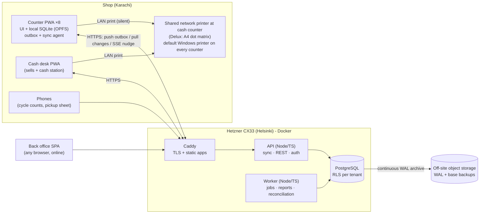

# Architecture

| | |
|---|---|
| **Status** | Draft for owner review |
| **Related** | [PRD](01-PRD.md) · [Data model](03-DATA-MODEL.md) · [Posting rules](04-ACCOUNTING-POSTING-RULES.md) · [Decisions](06-DECISION-LOG.md) |

Items marked **(proposed)** are technical defaults chosen by the architect that the owner has not explicitly decided. They are listed in the decision log for confirmation.

---

## 1. System overview



**Core idea:** each counter is an **autonomous node**. It reads only from its local database and writes finalized documents to a local outbox. Network access is never on the checkout path. The cloud is the system of record that every node converges to.

## 2. Technology stack

| Layer | Choice | Notes |
|---|---|---|
| Language | **TypeScript** everywhere (D-027) | One shared domain package for checkout rules |
| POS app | React + Vite **PWA** (D-010) | Chromium only (Chrome/Edge), installed as an app |
| POS local DB | **SQLite WASM** in a dedicated Web Worker, persisted on OPFS with the `opfs-sahpool` VFS **(proposed)** | Real SQL and transactions. Does not need cross-origin-isolation headers. |
| POS search | In-memory index in a worker, built from the local DB at boot and patched on sync **(proposed)** | 20k items easily meets ≤ 100 ms. Custom normalizer for part numbers. |
| Back office | React + Vite SPA (online only) | Shares UI and contract packages with the POS |
| UI components | **shadcn/ui** (Radix primitives + **Tailwind CSS**), copied into `packages/ui` and themed with the prototype design tokens (D-066) | Accessible, keyboard-friendly, RTL-ready (logical utilities + Radix direction), only used components are bundled |
| UI support libraries | TanStack Table + Virtual (tables), React Hook Form + Zod (forms, same schemas as `packages/contracts`), TanStack Router + Query (back office), i18next (i18n/RTL), Lucide (icons), `Intl` (number, currency, date formatting) | POS keeps dependencies minimal for fast start on old PCs |
| API | Node.js (current LTS) + **Fastify** **(proposed)** | Zod-typed routes. OpenAPI generated for future integrations and AI agents. |
| ORM / SQL | **Drizzle** **(proposed)** | SQL-first, typed. Easy to run `SET LOCAL` for RLS per transaction. |
| Database | **PostgreSQL** (17+) | RLS, `xid8` change feed, JSONB for settings and legacy attributes |
| Jobs | Postgres-backed queue (e.g. pg-boss / graphile-worker) **(proposed)** | No Redis to operate |
| Realtime nudge | Server-Sent Events | "Changes available" and live cash queue when online |
| Reverse proxy | **Caddy** **(proposed)** | Automatic TLS, serves static apps |
| Hosting | Hetzner CX33 (4 vCPU, 8 GB RAM, 80 GB), Helsinki (D-062) | Docker Compose, no provider-specific services |
| Backups | **pgBackRest** to Backblaze B2 (a **different provider**), encrypted (D-076, D-077) | RPO ≤ 5 min |
| Testing | Vitest (unit, golden cases), Postgres integration tests, Playwright (incl. offline e2e) | See §12 |

## 3. Repository layout (proposed)

```
apps/
  pos/            # Counter + cash desk PWA (offline-first)
  backoffice/     # Admin/ERP SPA (online)
  api/            # Fastify server: auth, REST, sync endpoints
  worker/         # Background jobs (reconciliation, reports, reorder list, notifications)
packages/
  domain/         # PURE TS business rules shared by pos + api (no I/O): money, pricing,
                  # bill math, tender/change, returns eligibility, credit checks,
                  # role limits, numbering, bill code (barcode/QR) codec, document validation
  contracts/      # Zod schemas: REST DTOs, sync payloads (versioned), bill code payloads
  db/             # Drizzle schema, SQL migrations, RLS policies, seed templates (CoA, roles)
  posting/        # Posting engine: document -> stock/party/GL entries (server-side)
  ui/             # shadcn/ui components (Radix + Tailwind) themed with our tokens,
                  # own keyboard-shortcut layer, i18next setup
tools/
  legacy-import/  # SSMS script parser -> staging -> transform -> load (+ reports)
docs/             # Requirements and design (this folder)
infra/            # docker-compose, Caddyfile, backup config, deploy scripts
```

**Rule:** checkout logic lives only in `packages/domain`. The POS uses it to compute, and the API uses it to re-validate. No business rule may be implemented twice.

## 4. POS offline design

### 4.1 Local data held per device
| Dataset | Approx. size (Delux) | Refresh |
|---|---|---|
| Items, identifiers, vehicle tags, categories, brands | ~20k items, ~40k identifiers | Incremental pull |
| Prices per tier, floors | ~60k rows | Incremental pull |
| Customers (+ balance snapshot, limit, tier, offline cap) | ~150 | Incremental pull |
| Users (+ PIN verifier), roles, permissions, limits | ~20 | Incremental pull |
| Tenant/branch settings, payment methods, expense categories, reason codes | small | Incremental pull |
| Stock balances per item/location (snapshot) | ~20k × 3 | Incremental pull |
| Branch sale bills, last 90 days (headers + lines), incl. legacy | ~13k bills | Incremental pull |
| This device's documents, last 30 days + outbox | — | Local |

The bootstrap download is ~20 MB uncompressed (a few MB gzipped).

### 4.2 Storage guardrails (mandatory, D-010)
1. On first run, call `navigator.storage.persist()`. If it is not granted, show a blocking setup screen. **Selling is disabled** until it is granted.
2. Every time the app opens, check that the local DB is readable, that its schema version matches, and that the outbox is intact. If a check fails, show a blocking alert and call the manager.
3. Counter PC setup: Chrome/Edge policies disable clearing browsing data and site data, the PWA is installed and launched with `--kiosk-printing`, and the bill printer (Delux: the shared network dot-matrix printer) is installed in Windows and set as the default printer. For half-page bills, a custom paper size is defined in Windows. A setup script and checklist are provided in `infra/`.
4. **Never drop or rebuild the local DB while the outbox holds unsynced documents.** Schema migrations run in place. A full rebuild from a server snapshot is only allowed when the outbox is empty.
5. App updates (service worker): a new version downloads in the background and **activates only when no bill is open**. The server accepts push payloads from version N-1.
6. The architecture is **wrapper-ready**: no PWA-only assumptions leak into the domain layer, so the same app can be packaged as a desktop app (e.g. Tauri) later.

### 4.3 Device identity, staff PIN and overrides
- **Enrollment:** a manager creates a one-time enrollment code in the back office and enters it on the device. The device then:
  1. generates a non-extractable **ECDSA P-256 key pair** with WebCrypto, stored in IndexedDB
  2. registers the public key with the server
  3. receives a refreshable device token.
- **Staff unlock:** the user picks their name (or types a short user code) and enters their PIN, which is checked locally against a slow hash (PBKDF2/Argon2) synced from the server. After 5 wrong attempts the user is locked on that device until a manager unlocks it.
  - **Honest limit:** a 4–6 digit PIN cannot resist offline brute force by someone who already controls an enrolled device. PINs give **accountability on a trusted shop device**, not strong authentication. Back-office login always needs a password, and PINs are never accepted by the back office.
- **Overrides:** the approver enters their PIN on the same screen. The device writes an override record (approver, reason, type, values) into the document, signed with the document.
- **Revocation:** revoking a device in the back office blocks its next sync. Documents it already created are still accepted, flagged for review.

### 4.4 Document numbering and time
- Number series per device and family: `S` sales/returns/exchanges, `H` cash handovers and refund payouts, `R` collections, `M` cash movements, `Z` cash session close. Format: `{deviceCode}-{family}{seq:6}`, e.g. `C03-S000412`. Gapless and never reused (voids keep their number).
- `uuid` (UUIDv7) generated on the device is the identity. The number is for humans.
- **Business date** = local date (tenant timezone) of `created_at − day_cutoff_hours` (default cutoff 04:00). Every device can compute it with no coordination.
- The device sends its clock with every push. If skew is greater than 5 minutes, the device health page and the exceptions report flag it. The server also stores `received_at`.

### 4.5 Bill code (barcode or signed QR)
Every printed bill carries a scannable code. Its main use is as the **offline path** for cash handovers and refund payouts. When online, the cashier normally confirms from the live queue (D-047), and scanning is just a shortcut to the exact bill. The code is also used to find the original bill for a return. The **print profile** chooses the code type (D-048).

**Barcode** (for dot-matrix printers; Delux):
- **Code 39** of the bill number and the amount due, e.g. `C03-S000412` + cash due. Code 39 is what the legacy bill already prints and scans on the Delux printer (D-055). Code 39 supports digits, capital letters, `-`, `.`, `/` and space, which fits this format. The exact format is confirmed in the Wave 1 print test.
- Not signed. That is acceptable when bills print on a shared printer at the cash counter, because the cashier takes the bill straight off the system's own printer, so a fake bill isn't practical.
- **Offline:** the cash desk records the handover from the bill number and amount in the code, and the server matches it when the counter syncs. It carries no line items, so an offline return of a bill from another unsynced counter uses the no-receipt PIN flow.

**Signed QR** (for thermal or laser printers):
- **Payload** (versioned, compact, base64url): payload version, document UUID, device code, sequence, business date, document kind, total, cash due / refund due, cash received. When the bill has **≤ 15 lines**, it also includes the full line list (item code, qty, unit price), so the cash desk holds a copy of the bill even if the counter's PC dies before syncing.
- **Signature:** ECDSA P-256 over the payload with the issuing device's private key. The public keys of all of a branch's devices are synced to every device, so any counter or cash desk can verify offline.
- A forged or altered QR fails verification. The cash desk refuses it and logs the attempt.
- Use it when receipts print at the counters and are carried to the cash desk by hand, because paper from outside the system then becomes possible.

### 4.6 Cash desk live queue
- When online, a counter pushes a finalized bill **immediately** (SYN-02). The server commits it and sends an SSE `queue-changed` event to the branch's cash desk devices, which then pull the queue delta. Target: ≤ 5 s from finalize to visible.
- The queue lists cash bills with `handover_status = pending` and refunds awaiting payout, grouped by salesman.
- Confirming creates a `cash_handover` document in the cash desk's own outbox (local-first, like any POS document). If the cashier corrects the cash received, the correction is stored on that handover record. The sale document is never touched.
- If the same bill is confirmed twice (queue plus scan, or a re-scan), the second attempt is rejected locally and also deduplicated by the server (unique per bill and kind).
- **Tenant setting `cash_handover_mode` (D-049):**
  - `required` (default; Delux) behaves as described above.
  - `off` hides the queue and handover scanning. When the server accepts a cash bill or refund, it creates an **automatic handover** (`method = auto`) in the same transaction. The handover is attached to the branch's cash session that was open at the bill's finalize time. If that session has already closed, the bill is listed as "late" on the day reconciliation.
  - Postings and reports are identical in both modes. Cash in transit simply clears automatically.

### 4.7 Cross-device situations while offline
| Situation | Behaviour |
|---|---|
| Live queue during an internet outage | It stops updating. The cashier scans each bill's code instead. Printing still works over the LAN. |
| Cash desk scans a bill from a counter that hasn't synced | Barcode: handover recorded from the bill number and amount. QR: also verified through its signature. The server matches it when the bill arrives. |
| Return of a bill made today at another, unsynced counter | QR profile: lines taken from the QR (≤ 15 lines). Otherwise, and always with the barcode profile: the no-receipt flow with a manager PIN, linked by bill number for later reconciliation. |
| Two counters sell the last unit | Both sales are accepted. Stock goes negative and an alert is raised. |
| Mechanic buys on credit at three counters | Each counter applies the limit plus the **offline daily cap**. Breaches are flagged at sync. |
| Price changed in the back office during an outage | Counters keep selling at the old price until sync. This is expected and not flagged. |
| Held bill | Device-local. It cannot be resumed elsewhere in the MVP. |

## 5. Sync protocol

### 5.1 Principles
1. **Documents are immutable and append-only** (D-002). Counters never modify shared records, so **there are no merge conflicts** for documents.
2. **Reference data has one writer.** Master data is edited only in the back office (online), so the server always wins.
3. **Derived data is recomputed on the server.** Balances and stock are downloaded as snapshots. Clients overlay their own unsynced documents on top.
4. **Idempotent everything.** A document's UUID is its idempotency key. Re-sending is always safe.
5. **Accept, then flag (SYN-03).** A completed sale is a fact: the customer has left with the goods. The server rejects only malformed, unauthenticated or badly signed payloads. Rule violations, such as a below-floor price without a valid override, become **exceptions** for review.

### 5.2 Upstream: push
```
POST /sync/push  { deviceId, clientVersion, deviceClock, documents: [ {id, family, seq, payload, signature} ... ] }
→ 200 { results: [ {id, status: accepted|duplicate|rejected, exceptions:[...], serverSeq} ... ] }
```
- The client sends outbox entries **in sequence order**, in batches of up to 100. When online, a push is triggered **immediately on finalize** (not on a timer), so the bill reaches the cash desk queue within seconds (§4.6).
- The server, per document, in **one database transaction**:
  1. verifies the device token and signature
  2. validates the schema (`packages/contracts`)
  3. re-validates the business rules (`packages/domain`) and records exceptions
  4. inserts the document, then runs the **posting engine** (stock, party and GL entries) in the same transaction
  5. records the result in `sync_inbox`.
- A duplicate ID returns the stored original result.
- **Sequence gaps** (e.g. 411 then 413) are recorded. The device is asked to re-send. The gap stays visible on the device health page until it is resolved.
- Client retry uses exponential backoff with jitter. An entry is removed from the outbox only after an `accepted` or `duplicate` acknowledgement. A `rejected` entry is quarantined and shown in a "needs attention" list, never silently dropped.

### 5.3 Downstream: pull
```
GET /sync/pull?cursor=<opaque>&datasets=items,prices,customers,...  → { changes:[...], cursor, hasMore }
```
- Every syncable table has `row_version` and `txid` (`xid8`) columns, set by a trigger on insert and update. Deletes are soft (`deleted_at`) so tombstones sync.
- **No skipped rows:** a pull only returns rows whose `txid < pg_snapshot_xmin(pg_current_snapshot())`, ordered by `(txid, row_version)`. A slow transaction can never commit "behind" a cursor the client has already passed. Plain sequence or `updated_at` cursors are **not allowed**: they skip rows under concurrency.
- Results are scoped to the device's tenant and branch, enforced by RLS.
- **Bootstrap:** a new device downloads a gzipped NDJSON snapshot per dataset with its cursor, then switches to incremental pulls.
- **Nudge:** when online, the device holds an SSE connection and the server sends `changes-available` after relevant commits. The device then pulls. Without SSE it polls every 60 s.

### 5.4 Disaster recovery
After a server restore to time T, devices re-push documents from their 30-day local history (SYN-05). Idempotency dedupes everything after T, and anything created after T is restored from the counters.

## 6. Multi-tenancy and security

### 6.1 Tenant hierarchy
`Tenant → Branch → Location (Shop / Godown / Damaged)` and `Branch → Device`. Users belong to a tenant and have role assignments, optionally per branch.

### 6.2 Row-level security
- Every tenant-owned table has `tenant_id uuid not null` plus an RLS policy `tenant_id = current_setting('app.tenant_id')::uuid`. RLS is `FORCE`d.
- The application connects as a **non-owner** role without `BYPASSRLS`. Each request runs in a transaction that starts with `SET LOCAL app.tenant_id = ...` (and `app.user_id`, `app.device_id` for auditing).
- Migrations run as a separate owner role. Platform-admin tooling uses a separate, audited path.
- **CI test:** every table in the schema either has an RLS policy or is on an explicit allow-list of global tables (e.g. currencies). Otherwise the build fails.

### 6.3 Authentication and authorization
- **Back office:** username/email and password (Argon2id), HTTP-only `SameSite=Strict` session cookie, optional TOTP for Owner/Accountant (Phase 2).
- **POS device:** device token (short-lived access + rotating refresh) plus ECDSA document signatures. The user is identified by PIN (§4.3).
- **Authorization:** permission strings (e.g. `pos.sale.create`, `pos.price.below_floor`, `pos.void`, `pos.return.create`, `pos.return.no_receipt`, `pos.return.outside_policy`, `cash.session.close`, `inv.adjust`, `pur.receive`, `acc.journal.post`, `cost.view`) plus numeric limits per role. They are evaluated by `packages/domain` on the device and again on the server.
- **Missing permission at the POS:** when an action needs a permission the unlocked user doesn't have (e.g. `pos.return.create`), the screen asks for the PIN of a user who has it. The approval is stored as an `override` on the document. It is never a reason to block the work entirely.

### 6.4 Audit
- An append-only `audit_log` records master-data changes (before/after JSON), logins, device events, overrides, voids, period locks and settings.
- Documents carry `created_by_user_id`, `device_id`, and `approved_by_user_id` for overrides. Nothing is ever hard-deleted.

### 6.5 Data protection
- Legacy dumps contain customer contacts and employee names. **They are never committed to git or uploaded to the server**. Only the transformed import is.
- National ID numbers (CNIC) are not migrated (only 2 records exist).
- Local POS data relies on OS-level protection (each counter has a Windows login). Encrypting the local DB is Phase 2.

## 7. Ledgers and the posting engine
- **Documents** (sales, goods receipts, cash movements, journals…) are the only things users create.
- The **posting engine** (`packages/posting`) turns each accepted document into:
  - `stock_movements`: quantity and value per item and location
  - `party_ledger_entries`: customer and supplier sub-ledgers
  - `journal_entries` / `journal_lines`: the GL.
- Posting happens **in the same transaction** as document acceptance. Balances (`stock_balances`, `party_balances`) are updated in that same transaction.
- Every ledger row references its source document. A **rebuild** command can regenerate all ledgers for a tenant from documents, e.g. after a posting-rule fix. Rebuilding any period on or before the lock date first requires an explicit, audited unlock. Otherwise the rebuild runs in compare-only (diagnostic) mode.
- **Weighted average cost:** one average per item per tenant. Outbound movements are valued at the average **at posting time** (in sync arrival order). Inbound receipts re-average. When on-hand is ≤ 0 before a receipt, the new average equals the receipt cost. Small differences from late-synced offline sales are accepted and documented (D-017). A re-costing job is a Phase 2 option.
- Detailed rules: [04-ACCOUNTING-POSTING-RULES.md](04-ACCOUNTING-POSTING-RULES.md).

## 8. Printing

| Output | Where | How |
|---|---|---|
| Bill / receipt (sale, return, exchange, collection, cash-out, Z report) | Counters, cash desk | HTML/CSS template chosen by the device's **print profile** (A4, A5/half page, 80 mm, 58 mm). Printed silently with `--kiosk-printing` to the device's **default Windows printer**, which may be a shared network printer. One keystroke. |
| A4/A5 invoice, PO, statement | Back office | Print-optimized HTML/PDF with the browser print dialog |
| Barcode labels (legacy format) | Back office | PDF at the label size, printed to the label printer through the dialog |
| Pickup run sheet, count sheets | Back office / phone | Responsive HTML, optional print |

**Print profiles (D-048):**
- **Fields:** paper format, bill code type (barcode or signed QR), copies (1–2; a second copy is rendered as a second page of the same print job), and template options (header lines, policy text).
- **Defaults:** a tenant default, overridable per device.
- **Constraint:** silent printing can only target the device's default printer, so each device has exactly one bill printer.

**Shared network printer (Delux):** one network-attached A4 dot-matrix printer at the cash counter is installed in Windows on every counter and set as the default printer. Printing goes over the LAN, so it keeps working when the internet is down.

**Dot-matrix considerations:**
- Browsers send pages as graphics, not in the printer's fast plain-text mode, so printing is slower and noisier than an old desktop app's.
- The layout is kept light: no shading, monospace-friendly, a large barcode.
- **Wave 1, week 1:** measure print speed and barcode scannability on the real printer.
- **Fallback if it's too slow:** a small local print helper on each counter that sends plain text (ESC/P) directly to the printer. This adds an install step, so it is used only if the test fails.

**Cash drawer:** it opens through a thermal printer's "open drawer on print" option where one is attached, otherwise with the drawer's own key or button. Dot-matrix printers can't trigger the drawer.

## 9. Deployment and operations (Hetzner CX33, Helsinki)

```
docker compose:
  caddy      : TLS (Let's Encrypt), serves apps/pos + apps/backoffice static builds, proxies /api
  api        : Node, stateless (can scale to 2 replicas on the same VPS)
  worker     : Node, background jobs
  postgres   : PostgreSQL 17+, not exposed publicly; WAL-G/pgBackRest sidecar
  (staging)  : separate compose project + own database and domain on the same server, hard limits
               (about 1.5 GB RAM / 1 vCPU), started only when testing; moves to its own small CX23 before the pilot
```

| Concern | Requirement |
|---|---|
| Backups | pgBackRest to Backblaze B2 (US East), encrypted with AES-256 before upload, sized for B2's free daily limits (D-076, D-077):<br>• WAL archived every 5 min (RPO ≤ 5 min)<br>• full backup on the 1st of each month, differential every night at 03:00 Karachi<br>• 12 monthly fulls kept; restore to any moment in the last 30+ days<br>The passphrase is kept offline by the owner. |
| Restore drill | Monthly, into a **throwaway container** (never staging, which is less protected), timed and logged in `docs/modules/devops/restore-drills.md`. A canary table measures the real data loss. `erp-db restore-drill` on the server (D-076). **Before go-live: a full drill with real data.** |
| Hardening | SSH keys only, no root login, no passwords; Hetzner Cloud Firewall + ufw (only 22, 80, 443); fail2ban; unattended security upgrades after hours; Postgres listening only on the Docker network. SSH is open to any IP, because the owner's IP is dynamic and GitHub Actions uses many IPs (D-073). Setup lives in `infra/` and is rebuildable from git. |
| Secrets | Environment files outside git. Rotated on staff changes. |
| Monitoring | See §11: Sentry, Grafana Cloud (logs, metrics, traces via OpenTelemetry + Alloy agent, uptime checks), Slack alerts from Grafana with email backup for critical ones (D-086). |
| Deploy | GitHub Actions + Docker Compose over SSH. No deploy platform (Coolify, Kamal…) on the server (D-063). See §9.1. |
| Portability | No Hetzner-specific APIs. Moving to a UAE region or managed Postgres = restore a backup plus a DNS change. |

### 9.0 Domains (D-065)

| Address | What |
|---|---|
| `pos.zorbixtechnologies.com` | POS PWA (counters, cash desk) |
| `app.zorbixtechnologies.com` | Back office |
| `staging-pos.zorbixtechnologies.com`, `staging-app.zorbixtechnologies.com` | Staging |
| `status.zorbixtechnologies.com` (optional) | Public status page (UptimeRobot) |

- **POS on its own subdomain:** the browser keeps service workers, OPFS data and storage permission **per origin**, so nothing in the back office (deploys, cache, clearing site data) can touch a counter's unsynced bills.
- **The POS origin must never change:** moving it would orphan each counter's local database and force re-enrollment.
- **API:** served as `/api` on each app's own origin through Caddy, which avoids CORS and keeps `SameSite=Strict` cookies simple. A separate `api.` subdomain can be added later for third-party integrations.
- **Certificates:** TLS from Let's Encrypt, issued automatically by Caddy.
- **DNS:** A records for each subdomain point to the production (or staging) server IP. The owner adds them in Wave 0.
- **Tenants:** all tenants share these addresses in the MVP; the tenant comes from the login or the device enrollment. Per-tenant subdomains for branding are a later option.
- **Marketing:** a product page on `zorbixtechnologies.com`. A separate product domain is optional, once the product name is final. It would only host marketing and signup and link to the app addresses above, which never move.

### 9.1 Branches, CI/CD and environments (D-063)

| Environment | Where | Deployed from | How |
|---|---|---|---|
| **CI test runs** | GitHub Actions runners (free) | Every push and pull request | Lint, type check, unit tests, integration tests against a throwaway PostgreSQL, build. Nightly: Playwright end-to-end flows and a backup-freshness check. |
| **Staging** | Same CX33, separate compose project with resource limits, on demand. Its own CX23 before the December pilot. | `staging` branch | **Automatic** on every merge to `staging` |
| **Production** | Hetzner CX33, Helsinki | `main` branch | **Merging `staging` → `main` is the release.** It deploys automatically, but only **outside shop hours (10:00–20:00 Asia/Karachi)**. A merge during hours waits until after closing. Emergency override via a manual "Run workflow". |

- **Work flow:** feature work → `staging` (test on staging) → pull request `staging` → `main` → merge = release.
- **Docs-only changes** (`docs/**`, `*.md`) never trigger a deploy. Like code, they go to `staging` by pull request and reach `main` with the next release, so `main` always has exactly the tree staging tested (D-080).
- **Each deploy:** pull images → run database migrations (if a migration fails, the old version keeps running) → start → health check. If the health check fails, the previous image is restored automatically and an alert is sent.
- **Rollback:** revert the merge on `main`, which redeploys the previous version.
- **Limit of the free GitHub plan:** branch protection is not enforced on private repositories, so "only merge `main` through a pull request" is a discipline rule, not a technical lock.

## 10. Extensibility built in now (cheap now, expensive later)
- **Tax engine:** tax codes on items and tax lines on document lines exist from day 1 (all 0%). The tenant setting chooses tax-inclusive or tax-exclusive pricing.
- **Fiscal adapter interface:** `FiscalAdapter.registerInvoice(doc) → {fiscalNo, qr}` with a no-op implementation. FBR POS (Pakistan) and UAE e-invoicing become adapters with their own offline queue.
- **Industry-agnostic core:** auto-parts concepts use generic names: `item_identifiers` (barcode / OEM / alternate), `item_compatibility` (subject = vehicle; make / model / years). Another vertical reuses them or ignores them.
- **Locale and currency:** currency minor units come from the tenant. Formatting uses the tenant locale. The UI is RTL-ready.
- **AI agents later:** documents and ledgers are clean, append-only, and exposed through a typed OpenAPI. Agents (reorder, pricing, catalog cleanup, anomaly detection) read through the API and write **proposals** (e.g. a draft PO or price suggestion) that a human approves. They never write ledgers directly.

## 11. Logging, monitoring and observability (D-064, D-086)

Goal: when something goes wrong, we can answer **what happened, to which bill, on which device, for which tenant, and why**, from one place, without SSH-ing into the server.

### 11.1 Stack

| Signal | Tool | Runs where | Cost |
|---|---|---|---|
| **Errors** (API, worker, POS, back office) | **Sentry** (EU): stack traces, release/version, breadcrumbs, source maps; projects `erp-server` and `erp-web`; its own alerts by email | Hosted | Free plan |
| **Logs** | Structured JSON logs (pino) → **Grafana Loki** | Hosted (Grafana Cloud free tier; limits and retention, about 14 days, checked at setup) | Free |
| **Metrics** | OpenTelemetry / Prometheus metrics → **Grafana Cloud** (Mimir) | Hosted | Free |
| **Traces** | **OpenTelemetry** traces for API requests, sync pushes, postings and DB queries → Grafana Tempo | Hosted | Free |
| **Collector** | **Grafana Alloy** agent: Docker log files (no Docker socket), server metrics, backup age, PostgreSQL metrics (exporter + `pg_stat_statements`), OTLP from the apps | On the CX33 (about 80 MB; limit 300 MB) | Free |
| **Uptime** | **Grafana Synthetic Monitoring**: `/api/health` of app, POS and staging every 5 minutes, with certificate expiry (D-086; UptimeRobot's free plan is non-commercial only) | Hosted | Free (about 50k of 100k checks a month) |
| **Dashboards and alert rules** | Grafana Cloud | Hosted | Free |
| **Alert delivery** | **Slack** from Grafana alerting: `#erp-critical` (phone notifications on) and `#erp-alerts`, plus **email** backup for critical alerts | Hosted | Free |

- **Why hosted instead of self-hosted Grafana/Prometheus:** a full self-hosted stack would use about 1–1.5 GB of the 8 GB production server, and it would go down with the server it's watching.
- **Vendor-neutral:** instrumentation is **OpenTelemetry**, so we can switch to self-hosted or another vendor later without code changes.

### 11.2 Correlation: every log line can be traced

- **Every request** gets a `request_id` and a trace ID, returned in the response header and shown in error messages ("Reference: 7F3K…").
- **Every log line and Sentry event** carries: `tenant_id`, `branch_id`, `device_id`, `user_id`, `request_id`, `trace_id`, app version, environment (prod/staging) and, where relevant, `document_id` / `bill_number`.
- **POS devices** send `device_id`, app version and document IDs with every sync push. The server logs each document's result (accepted / duplicate / rejected + reason) against those IDs.
- **Database:** each transaction runs `SET LOCAL app.request_id`, so slow-query logs and the audit log link back to the request.

### 11.3 POS-side diagnostics (works offline)

- Each counter keeps a **local diagnostic log** (a ring buffer of the last ~5,000 events in its SQLite database): sync attempts and results, print jobs, storage checks, PIN lockouts, errors, app updates.
- The diagnostic log, **device health** (PLT-09: app/schema version, unsynced count and oldest age, last push/pull, storage persisted, storage usage, clock skew) and **POS errors** are uploaded with the next sync, so errors that happen offline still reach Sentry and the logs later.
- **"Send diagnostics" (manager):** on demand, uploads the full local log plus a health snapshot for support, without the customer having to describe the problem.

### 11.4 Document timeline (support view)

The back office (owner/platform admin only) has a **"Trace a bill"** view. Enter a bill number and see its whole life in one timeline:
- created on device X by user Y (device time)
- printed
- each sync attempt and result
- accepted on the server (received time)
- exceptions raised
- stock / GL / party postings
- cash handover or offline scan, void, returns against it.

This answers most "where did this bill / this cash go?" questions in seconds (PLT-12).

### 11.5 Metrics we watch

| Area | Metrics |
|---|---|
| **API** | Request rate, error rate, latency (p50/p95), by route and tenant |
| **Sync** | Push and pull rate, batch size, rejected documents, duplicate rate, sequence gaps, **finalize → visible in cash queue** latency |
| **Devices** | Unsynced documents per device, oldest unsynced age, offline duration, app versions in use, devices without persistent storage |
| **Posting / accounting** | Posting duration, **posting errors (must be 0)**, unbalanced-entry attempts, rebuild diffs |
| **Business day** | Bills, handovers pending, missing handovers, exceptions by type, provisional days |
| **Database** | Size, connections, slow queries (`pg_stat_statements`), locks, replication/WAL archive lag, **backup age** |
| **Server** | CPU, RAM, disk %, Docker container restarts; staging resource use |

**Dashboards:** *System*, *API & sync*, *Devices*, *Business day & cash*, *Database & backups*. Every view can be filtered by tenant and environment.

### 11.6 Alerts (Slack)

| Severity → channel | Alert |
|---|---|
| **Critical → `#erp-critical` + email** | API or website down. Posting error. Backup older than 15 min (WAL) or 26 h (base). Disk > 85%. A device with unsynced bills > 4 h while others are online. Repeated sync rejections from one device. Database unreachable. Deploy health check failed / auto-rollback. |
| **Warning → `#erp-alerts`** | New Sentry error type. Error rate or p95 latency above threshold. Sequence gap. Clock skew > 5 min. Device without persistent storage. A day provisional > 48 h. Exceptions (missing handover, cash on voided bill, offline cap breach). SSL certificate expiring within 14 days. |

- Each critical alert links to a short **runbook** (`docs/runbooks/`): what it means, how to check, how to fix.
- Alerts are grouped to avoid floods: one message per incident, plus a "resolved" message.

### 11.7 Privacy and retention

- **Never logged:** passwords, PINs, PIN verifiers, device tokens, private keys, full card or wallet details. A logger redaction list enforces this, with a CI test.
- **Masked:** customer phone numbers (only the last 4 digits) and names in logs. Bill numbers and IDs are fine.
- **Retention:**
  - hosted logs and traces about 14 days (free-tier window)
  - Sentry per its plan
  - local server log files rotated, 30 days
  - POS diagnostic buffer about 5,000 events.
- **The audit log is separate:** it's business data in PostgreSQL, permanent, and not part of observability.
- **Staging** uses the same instrumentation, labelled `env=staging`, so problems can be reproduced the same way.

## 12. Testing strategy (solo developer: automate the dangerous parts)

**Test-first (TDD)** for `packages/domain`, `packages/posting`, the sync protocol and RLS, where a bug means wrong money or lost bills. Each rule's golden test cases are written before the code. Screens are covered by a few end-to-end Playwright flows rather than test-first (D-063).

| Layer | What | Tool |
|---|---|---|
| Domain | Golden test cases (JSON input → expected output) for bill math, rounding, tier/floor/limit rules, returns eligibility, credit availability. 100% branch coverage on `packages/domain`. | Vitest |
| Posting | For every document type: expected stock, party and GL lines. Debits = credits. Rebuild equals live result. | Vitest + Postgres |
| Sync | Duplicate pushes, out-of-order batches, sequence gaps, server restore + re-push, concurrent back-office edits during pull (no skipped rows). | Integration tests |
| RLS | Every table has a policy. A cross-tenant read/write attempt returns nothing or fails. | Integration tests |
| E2E | A full shop day in the browser: sell → go offline → sell, return, hand over → reconnect → reconcile. Printing mocked. | Playwright |
| Migration | Importer on the real dump; reconciliation totals asserted. | Script + report |
