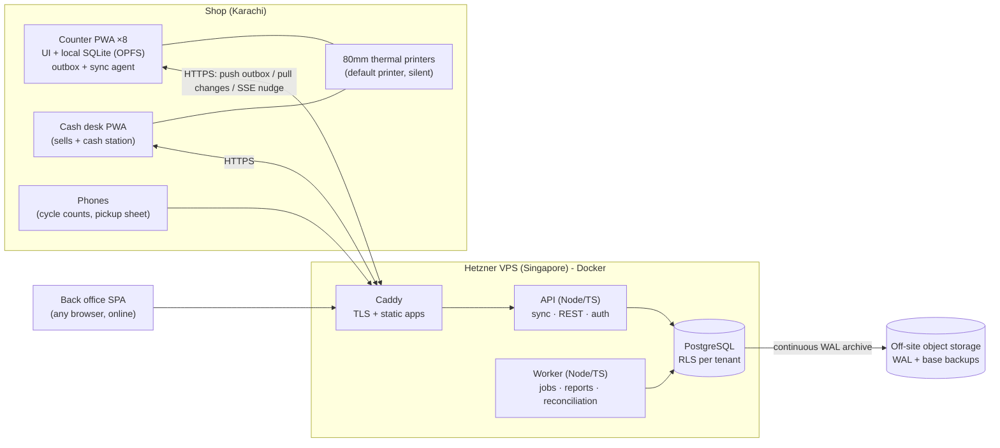

# Architecture

| | |
|---|---|
| **Status** | Draft for owner review |
| **Related** | [PRD](01-PRD.md) · [Data model](03-DATA-MODEL.md) · [Posting rules](04-ACCOUNTING-POSTING-RULES.md) · [Decisions](06-DECISION-LOG.md) |

Items marked **(proposed)** are technical defaults chosen by the architect that the owner has not explicitly decided. They are listed in the decision log for confirmation.

---

## 1. System overview



**Core idea:** each counter is an **autonomous node**. It reads only from its local database and writes finalized documents to a local outbox. Network access is never on the checkout path. The cloud is the system of record that every node converges to.

## 2. Technology stack

| Layer | Choice | Notes |
|---|---|---|
| Language | **TypeScript** everywhere (D-027) | One shared domain package for checkout rules |
| POS app | React + Vite **PWA** (D-010) | Chromium only (Chrome/Edge), installed as an app |
| POS local DB | **SQLite WASM** in a dedicated Web Worker, persisted on OPFS with the `opfs-sahpool` VFS **(proposed)** | Real SQL and transactions. Does not need cross-origin-isolation headers. |
| POS search | In-memory index in a worker, built from the local DB at boot and patched on sync **(proposed)** | 20k items easily meets ≤ 100 ms. Custom normalizer for part numbers. |
| Back office | React + Vite SPA (online only) | Shares UI and contract packages with the POS |
| API | Node.js (current LTS) + **Fastify** **(proposed)** | Zod-typed routes. OpenAPI generated for future integrations and AI agents. |
| ORM / SQL | **Drizzle** **(proposed)** | SQL-first, typed. Easy to run `SET LOCAL` for RLS per transaction. |
| Database | **PostgreSQL** (17+) | RLS, `xid8` change feed, JSONB for settings and legacy attributes |
| Jobs | Postgres-backed queue (e.g. pg-boss / graphile-worker) **(proposed)** | No Redis to operate |
| Realtime nudge | Server-Sent Events | "Changes available" and live cash queue when online |
| Reverse proxy | **Caddy** **(proposed)** | Automatic TLS, serves static apps |
| Hosting | Hetzner VPS, Singapore (D-029) | Docker Compose, no provider-specific services |
| Backups | WAL-G or pgBackRest to object storage at a **different provider** **(proposed)** | RPO ≤ 5 min |
| Testing | Vitest (unit, golden cases), Postgres integration tests, Playwright (incl. offline e2e) | See §12 |

## 3. Repository layout (proposed)

```
apps/
  pos/            # Counter + cash desk PWA (offline-first)
  backoffice/     # Admin/ERP SPA (online)
  api/            # Fastify server: auth, REST, sync endpoints
  worker/         # Background jobs (reconciliation, reports, reorder list, notifications)
packages/
  domain/         # PURE TS business rules shared by pos + api (no I/O): money, pricing,
                  # bill math, tender/change, returns eligibility, credit checks,
                  # role limits, numbering, QR codec, document validation
  contracts/      # Zod schemas: REST DTOs, sync payloads (versioned), QR payload
  db/             # Drizzle schema, SQL migrations, RLS policies, seed templates (CoA, roles)
  posting/        # Posting engine: document -> stock/party/GL entries (server-side)
  ui/             # Shared React components, keyboard shortcut system, i18n setup
tools/
  legacy-import/  # SSMS script parser -> staging -> transform -> load (+ reports)
docs/             # Requirements and design (this folder)
infra/            # docker-compose, Caddyfile, backup config, deploy scripts
```

**Rule:** checkout logic lives only in `packages/domain`. The POS uses it to compute, and the API uses it to re-validate. No business rule may be implemented twice.

## 4. POS offline design

### 4.1 Local data held per device
| Dataset | Approx. size (Delux) | Refresh |
|---|---|---|
| Items, identifiers, vehicle tags, categories, brands | ~20k items, ~40k identifiers | Incremental pull |
| Prices per tier, floors | ~60k rows | Incremental pull |
| Customers (+ balance snapshot, limit, tier, offline cap) | ~150 | Incremental pull |
| Users (+ PIN verifier), roles, permissions, limits | ~20 | Incremental pull |
| Tenant/branch settings, payment methods, expense categories, reason codes | small | Incremental pull |
| Stock balances per item/location (snapshot) | ~20k × 3 | Incremental pull |
| Branch sale bills, last 90 days (headers + lines), incl. legacy | ~13k bills | Incremental pull |
| This device's documents, last 30 days + outbox | — | Local |

The bootstrap download is ~20 MB uncompressed (a few MB gzipped).

### 4.2 Storage guardrails (mandatory, D-010)
1. On first run, call `navigator.storage.persist()`. If it is not granted, show a blocking setup screen. **Selling is disabled** until it is granted.
2. Every time the app opens, check that the local DB is readable, that its schema version matches, and that the outbox is intact. If a check fails, show a blocking alert and call the manager.
3. Counter PC setup: Chrome/Edge policies disable clearing browsing data and site data, the PWA is installed and launched with `--kiosk-printing`, and the thermal printer is set as the default printer. A setup script and checklist are provided in `infra/`.
4. **Never drop or rebuild the local DB while the outbox holds unsynced documents.** Schema migrations run in place. A full rebuild from a server snapshot is only allowed when the outbox is empty.
5. App updates (service worker): a new version downloads in the background and **activates only when no bill is open**. The server accepts push payloads from version N-1.
6. The architecture is **wrapper-ready**: no PWA-only assumptions leak into the domain layer, so the same app can be packaged as a desktop app (e.g. Tauri) later.

### 4.3 Device identity, staff PIN and overrides
- **Enrollment:** a manager creates a one-time enrollment code in the back office and enters it on the device. The device then:
  1. generates a non-extractable **ECDSA P-256 key pair** with WebCrypto, stored in IndexedDB
  2. registers the public key with the server
  3. receives a refreshable device token.
- **Staff unlock:** the user picks their name (or types a short user code) and enters their PIN, which is checked locally against a slow hash (PBKDF2/Argon2) synced from the server. After 5 wrong attempts the user is locked on that device until a manager unlocks it.
  - **Honest limit:** a 4–6 digit PIN cannot resist offline brute force by someone who already controls an enrolled device. PINs give **accountability on a trusted shop device**, not strong authentication. Back-office login always needs a password, and PINs are never accepted by the back office.
- **Overrides:** the approver enters their PIN on the same screen. The device writes an override record (approver, reason, type, values) into the document, signed with the document.
- **Revocation:** revoking a device in the back office blocks its next sync. Documents it already created are still accepted, flagged for review.

### 4.4 Document numbering and time
- Number series per device and family: `S` sales/returns/exchanges, `R` collections, `M` cash movements, `Z` cash session close. Format: `{deviceCode}-{family}{seq:6}`, e.g. `C03-S000412`. Gapless and never reused (voids keep their number).
- `uuid` (UUIDv7) generated on the device is the identity. The number is for humans.
- **Business date** = local date (tenant timezone) of `created_at − day_cutoff_hours` (default cutoff 04:00). Every device can compute it with no coordination.
- The device sends its clock with every push. If skew is greater than 5 minutes, the device health page and the exceptions report flag it. The server also stores `received_at`.

### 4.5 Signed receipt QR
Purpose: an offline cash handover, refund payout or return of a bill from another counter, without trusting paper.

- **Payload** (versioned, compact, base64url): payload version, document UUID, device code, sequence, business date, document kind, total, cash due / refund due, amount tendered. When the bill has **≤ 15 lines**, it also includes the full line list (item code, qty, unit price), so the cash desk holds a copy of the bill even if the counter's PC dies before syncing.
- **Signature:** ECDSA P-256 over the payload with the issuing device's private key. The public keys of all of a branch's devices are synced to every device, so any counter or cash desk can verify offline.
- A forged or altered QR fails verification. The cash desk refuses it and logs the attempt.

### 4.6 Cross-device situations while offline
| Situation | Behaviour |
|---|---|
| Cash desk scans a bill from a counter that hasn't synced | Verified through the QR signature. Handover recorded. The server matches it when the bill arrives. |
| Return of a bill made today at another, unsynced counter | Lines taken from the QR (≤ 15 lines). Otherwise the no-receipt flow with a manager PIN, linked by bill number for later reconciliation. |
| Two counters sell the last unit | Both sales are accepted. Stock goes negative and an alert is raised. |
| Mechanic buys on credit at three counters | Each counter applies the limit plus the **offline daily cap**. Breaches are flagged at sync. |
| Price changed in the back office during an outage | Counters keep selling at the old price until sync. This is expected and not flagged. |
| Held bill | Device-local. It cannot be resumed elsewhere in the MVP. |

## 5. Sync protocol

### 5.1 Principles
1. **Documents are immutable and append-only** (D-002). Counters never modify shared records, so **there are no merge conflicts** for documents.
2. **Reference data has one writer.** Master data is edited only in the back office (online), so the server always wins.
3. **Derived data is recomputed on the server.** Balances and stock are downloaded as snapshots. Clients overlay their own unsynced documents on top.
4. **Idempotent everything.** A document's UUID is its idempotency key. Re-sending is always safe.
5. **Accept, then flag (SYN-03).** A completed sale is a fact: the customer has left with the goods. The server rejects only malformed, unauthenticated or badly signed payloads. Rule violations, such as a below-floor price without a valid override, become **exceptions** for review.

### 5.2 Upstream: push
```
POST /sync/push  { deviceId, clientVersion, deviceClock, documents: [ {id, family, seq, payload, signature} ... ] }
→ 200 { results: [ {id, status: accepted|duplicate|rejected, exceptions:[...], serverSeq} ... ] }
```
- The client sends outbox entries **in sequence order**, in batches of up to 100.
- The server, per document, in **one database transaction**:
  1. verifies the device token and signature
  2. validates the schema (`packages/contracts`)
  3. re-validates the business rules (`packages/domain`) and records exceptions
  4. inserts the document, then runs the **posting engine** (stock, party and GL entries) in the same transaction
  5. records the result in `sync_inbox`.
- A duplicate ID returns the stored original result.
- **Sequence gaps** (e.g. 411 then 413) are recorded. The device is asked to re-send. The gap stays visible on the device health page until it is resolved.
- Client retry uses exponential backoff with jitter. An entry is removed from the outbox only after an `accepted` or `duplicate` acknowledgement. A `rejected` entry is quarantined and shown in a "needs attention" list, never silently dropped.

### 5.3 Downstream: pull
```
GET /sync/pull?cursor=<opaque>&datasets=items,prices,customers,...  → { changes:[...], cursor, hasMore }
```
- Every syncable table has `row_version` and `txid` (`xid8`) columns, set by a trigger on insert and update. Deletes are soft (`deleted_at`) so tombstones sync.
- **No skipped rows:** a pull only returns rows whose `txid < pg_snapshot_xmin(pg_current_snapshot())`, ordered by `(txid, row_version)`. A slow transaction can never commit "behind" a cursor the client has already passed. Plain sequence or `updated_at` cursors are **not allowed**: they skip rows under concurrency.
- Results are scoped to the device's tenant and branch, enforced by RLS.
- **Bootstrap:** a new device downloads a gzipped NDJSON snapshot per dataset with its cursor, then switches to incremental pulls.
- **Nudge:** when online, the device holds an SSE connection and the server sends `changes-available` after relevant commits. The device then pulls. Without SSE it polls every 60 s.

### 5.4 Disaster recovery
After a server restore to time T, devices re-push documents from their 30-day local history (SYN-05). Idempotency dedupes everything after T, and anything created after T is restored from the counters.

## 6. Multi-tenancy and security

### 6.1 Tenant hierarchy
`Tenant → Branch → Location (Shop / Godown / Damaged)` and `Branch → Device`. Users belong to a tenant and have role assignments, optionally per branch.

### 6.2 Row-level security
- Every tenant-owned table has `tenant_id uuid not null` plus an RLS policy `tenant_id = current_setting('app.tenant_id')::uuid`. RLS is `FORCE`d.
- The application connects as a **non-owner** role without `BYPASSRLS`. Each request runs in a transaction that starts with `SET LOCAL app.tenant_id = ...` (and `app.user_id`, `app.device_id` for auditing).
- Migrations run as a separate owner role. Platform-admin tooling uses a separate, audited path.
- **CI test:** every table in the schema either has an RLS policy or is on an explicit allow-list of global tables (e.g. currencies). Otherwise the build fails.

### 6.3 Authentication and authorization
- **Back office:** username/email and password (Argon2id), HTTP-only `SameSite=Strict` session cookie, optional TOTP for Owner/Accountant (Phase 2).
- **POS device:** device token (short-lived access + rotating refresh) plus ECDSA document signatures. The user is identified by PIN (§4.3).
- **Authorization:** permission strings (e.g. `pos.sale.create`, `pos.price.below_floor`, `pos.void`, `pos.return.no_receipt`, `cash.session.close`, `inv.adjust`, `pur.receive`, `acc.journal.post`, `cost.view`) plus numeric limits per role. They are evaluated by `packages/domain` on the device and again on the server.

### 6.4 Audit
- An append-only `audit_log` records master-data changes (before/after JSON), logins, device events, overrides, voids, period locks and settings.
- Documents carry `created_by_user_id`, `device_id`, and `approved_by_user_id` for overrides. Nothing is ever hard-deleted.

### 6.5 Data protection
- Legacy dumps contain customer contacts and employee names. **They are never committed to git or uploaded to the server**. Only the transformed import is.
- National ID numbers (CNIC) are not migrated (only 2 records exist).
- Local POS data relies on OS-level protection (each counter has a Windows login). Encrypting the local DB is Phase 2.

## 7. Ledgers and the posting engine
- **Documents** (sales, goods receipts, cash movements, journals…) are the only things users create.
- The **posting engine** (`packages/posting`) turns each accepted document into:
  - `stock_movements`: quantity and value per item and location
  - `party_ledger_entries`: customer and supplier sub-ledgers
  - `journal_entries` / `journal_lines`: the GL.
- Posting happens **in the same transaction** as document acceptance. Balances (`stock_balances`, `party_balances`) are updated in that same transaction.
- Every ledger row references its source document. A **rebuild** command can regenerate all ledgers for a tenant from documents, e.g. after a posting-rule fix. Rebuilding any period on or before the lock date first requires an explicit, audited unlock. Otherwise the rebuild runs in compare-only (diagnostic) mode.
- **Weighted average cost:** one average per item per tenant. Outbound movements are valued at the average **at posting time** (in sync arrival order). Inbound receipts re-average. When on-hand is ≤ 0 before a receipt, the new average equals the receipt cost. Small differences from late-synced offline sales are accepted and documented (D-017). A re-costing job is a Phase 2 option.
- Detailed rules: [04-ACCOUNTING-POSTING-RULES.md](04-ACCOUNTING-POSTING-RULES.md).

## 8. Printing

| Output | Where | How |
|---|---|---|
| 80 mm receipt (sale, return, exchange, collection, cash-out, Z report) | Counters, cash desk | HTML/CSS receipt template, printed silently with `--kiosk-printing` to the default printer. One keystroke. |
| A4/A5 invoice, PO, statement | Back office | Print-optimized HTML/PDF with the browser print dialog |
| Barcode labels (legacy format) | Back office | PDF at the label size, printed to the label printer through the dialog |
| Pickup run sheet, count sheets | Back office / phone | Responsive HTML, optional print |

The cash drawer opens through the thermal printer driver's "open drawer on print" option at the cash desk, or with its manual key.

## 9. Deployment and operations (Hetzner VPS)

```
docker compose:
  caddy      : TLS (Let's Encrypt), serves apps/pos + apps/backoffice static builds, proxies /api
  api        : Node, stateless (can scale to 2 replicas on the same VPS)
  worker     : Node, background jobs
  postgres   : PostgreSQL 17+, not exposed publicly; WAL-G/pgBackRest sidecar
  (staging)  : separate compose project + database on the same VPS for MVP
```

| Concern | Requirement |
|---|---|
| Backups | Continuous WAL archiving plus a daily base backup to S3-compatible storage at **another provider**. Retention 30 days plus monthly snapshots for 12 months. Backups encrypted. |
| Restore drill | Monthly, into staging, timed, logged. **Before go-live: at least one full drill.** |
| Hardening | SSH keys only, no root login, firewall (only 80/443 and SSH from allowed IPs), unattended security upgrades, fail2ban, Postgres listening only on the Docker network. |
| Secrets | Environment files outside git. Rotated on staff changes. |
| Monitoring | External uptime check on `/health`, error tracking (e.g. Sentry) for API, worker, POS and back office, disk and Postgres alerts, backup-freshness alert (> 15 min without a WAL push). |
| Deploy | CI builds images → registry → SSH deploy (`compose pull && migrate && up -d`). Zero-downtime is not required (POS is offline-tolerant). Deploy outside shop hours. |
| Portability | No Hetzner-specific APIs. Moving to a UAE region or managed Postgres = restore a backup plus a DNS change. |

## 10. Extensibility built in now (cheap now, expensive later)
- **Tax engine:** tax codes on items and tax lines on document lines exist from day 1 (all 0%). The tenant setting chooses tax-inclusive or tax-exclusive pricing.
- **Fiscal adapter interface:** `FiscalAdapter.registerInvoice(doc) → {fiscalNo, qr}` with a no-op implementation. FBR POS (Pakistan) and UAE e-invoicing become adapters with their own offline queue.
- **Industry-agnostic core:** auto-parts concepts use generic names: `item_identifiers` (barcode / OEM / alternate), `item_compatibility` (subject = vehicle; make / model / years). Another vertical reuses them or ignores them.
- **Locale and currency:** currency minor units come from the tenant. Formatting uses the tenant locale. The UI is RTL-ready.
- **AI agents later:** documents and ledgers are clean, append-only, and exposed through a typed OpenAPI. Agents (reorder, pricing, catalog cleanup, anomaly detection) read through the API and write **proposals** (e.g. a draft PO or price suggestion) that a human approves. They never write ledgers directly.

## 11. Observability on devices
Each device reports with every sync, and on a timer when online: app version, schema version, unsynced count, oldest unsynced age, last successful push/pull, storage persisted (yes/no), storage usage, clock skew and recent errors. This feeds the back-office **Devices** page (PLT-09) and alerts (e.g. a device with more than 4 h of unsynced documents while others are online).

## 12. Testing strategy (solo developer: automate the dangerous parts)
| Layer | What | Tool |
|---|---|---|
| Domain | Golden test cases (JSON input → expected output) for bill math, rounding, tier/floor/limit rules, returns eligibility, credit availability. 100% branch coverage on `packages/domain`. | Vitest |
| Posting | For every document type: expected stock, party and GL lines. Debits = credits. Rebuild equals live result. | Vitest + Postgres |
| Sync | Duplicate pushes, out-of-order batches, sequence gaps, server restore + re-push, concurrent back-office edits during pull (no skipped rows). | Integration tests |
| RLS | Every table has a policy. A cross-tenant read/write attempt returns nothing or fails. | Integration tests |
| E2E | A full shop day in the browser: sell → go offline → sell, return, hand over → reconnect → reconcile. Printing mocked. | Playwright |
| Migration | Importer on the real dump; reconciliation totals asserted. | Script + report |
