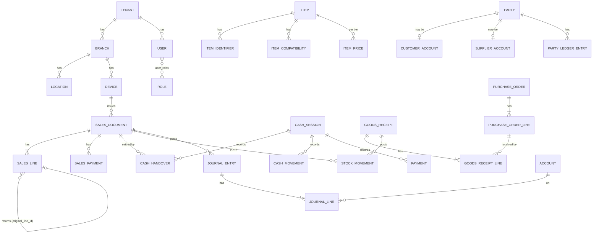

# Data Model (logical)

| | |
|---|---|
| **Status** | Draft for owner review. Logical model only; exact DDL is written at implementation. |
| **Related** | [Architecture](02-ARCHITECTURE.md) · [Posting rules](04-ACCOUNTING-POSTING-RULES.md) · [Migration](05-LEGACY-MIGRATION.md) |

---

## 1. Conventions (apply to every table unless stated)

| Convention | Rule |
|---|---|
| Primary key | `id uuid` (UUIDv7). For POS documents it is generated on the device. |
| Tenancy | `tenant_id uuid not null` plus an RLS policy. Global tables (currencies, countries) are explicitly allow-listed. |
| Human codes | `code` / `number` is unique per tenant (or per tenant + device for POS series). The UUID is the identity; the code is for people. |
| Money | `bigint` in **minor units** (paisa / fils). Never float or numeric for money. The tenant's `currency_minor_units` defines the scale. |
| Quantity | `numeric(14,3)`. In TypeScript, quantities are integer thousandths (`qty_milli`) inside `packages/domain`. |
| Rates / percent | Basis points `int` (1% = 100 bp). |
| Time | `timestamptz` (UTC). `business_date date` is computed with the tenant timezone and day cutoff ([Arch §4.4](02-ARCHITECTURE.md)). |
| Audit columns | `created_at`, `created_by_user_id`, `updated_at`, `updated_by_user_id` on master data. |
| Sync columns | Downloadable (synced) tables have `row_version bigint`, `txid xid8` (set by trigger) and `deleted_at` (soft delete). |
| Immutability | Rows in document and ledger tables are never updated after posting, except for workflow status fields (e.g. `handover_status`, `status: voided`). Every status change is also written to the audit log. |
| Legacy | Migrated rows keep `legacy jsonb` with the original IDs and values for traceability. |
| Schema and helpers | All tables are in schema `erp`, created by SQL migrations in `packages/db/migrations/` (D-078): • **tenant tables:** `SELECT erp.enable_tenant_rls('erp.<t>')` (forced RLS on `tenant_id = erp.current_tenant_id()`) • **synced tables:** also `erp.enable_sync` (`txid` / `row_version` by trigger, `DELETE` refused) • **audit columns:** `erp.enable_audit` • **default ID:** `erp.uuid_v7()` • **status columns:** `text` + `CHECK`, not enums |

Data in this document is grouped by area. Fields marked † are derived and maintained by the posting engine.

---

## 2. Platform

**tenants:** `name, legal_name, base_currency (ISO 4217), currency_minor_units, timezone (e.g. Asia/Karachi), locale, fiscal_year_start_month (1–12), fiscal_year_locked bool, tax_mode (none|inclusive|exclusive), cash_rounding_increment (minor units, e.g. 100 = Rs 1), day_cutoff_hour (Delux 4), closing_time (Delux 20:00), cash_handover_mode (required|off; Delux: required), lock_date, settings jsonb, status`

**branches:** `code, name, address, phone, receipt_header jsonb`

**locations:** `branch_id, code, name, kind (shop|storage|damaged), is_sellable`
- Delux: `SHOP` (sellable), `GODOWN` (storage), `DAMAGED` (not sellable).

**devices:** `branch_id, code (C01… counters, D01… cash desks, M01… mobile; never reused), name, kind (counter|cash_desk|mobile), public_key (ECDSA P-256, SPKI), status (active|revoked), enrolled_at, enrolled_by_user_id, revoked_at, revoked_by_user_id, print_profile_id (null = the tenant default)` (D-082, D-055)
- Still to come: `last_seen_at`, `app_version`, `health` in a separate device-health table (PLT-09), so routine check-ins don't create audit or sync noise.

**print_profiles:** `name, paper_format (a4|a5|thermal_80|thermal_58), code_type (barcode|signed_qr), copies (1|2), template_options jsonb (header lines, policy text, font size), is_tenant_default`
- Delux: one profile `A5 landscape dot matrix` (`paper_format = a5`), `barcode` (Code 39), 1 copy, the default for every device.
- At most one `is_tenant_default` per tenant.

**device_enrollment_codes:** `branch_id, kind, name, code_hash (SHA-256), created_by_user_id, expires_at (15 min), used_at, used_by_device_id`

**device_challenges:** `device_id, nonce_hash, expires_at (60 s), used_at`. A single-use nonce a device signs to get a token.

**device_tokens:** `device_id, token_hash, expires_at (15 min)`. Deleted when the device is revoked. See the [platform spec](modules/platform/spec.md).

**device_series** (server mirror for gap detection): `device_id, family (S|H|R|M|Z), last_accepted_seq, missing_seqs int[]`

**users:** `username, email, full_name, short_code (for quick PIN unlock), password_hash (Argon2id), pin_verifier (slow hash + salt), status (active|disabled), password_changed_at, must_change_password` (a generated password must be changed before anything else, D-083)
- Unique per tenant: `username` and `email` (case-insensitive), `short_code`.
- The audit log never stores `password_hash` or `pin_verifier`. Back-office login checks only `password_hash` (D-081).

**user_login_state:** `user_id, failed_logins, locked_until, last_login_at`. Kept apart from `users`, so logins don't create audit or sync noise. 5 failures → locked for 15 min.

**sessions:** `user_id, token_hash (SHA-256), created_at, expires_at (12 h), last_seen_at (idle 2 h), revoked_at, ip, user_agent`. Back office only.

**tenant_directory:** `code (e.g. delux) → tenant_id`. Used by the login, the one table readable across tenants, and it holds nothing else (D-081).

**roles:** `name, template_key (owner|manager|cashier|salesman|purchaser|accountant, or null for a custom role), permissions text[], limits jsonb`
- Permissions are catalog keys from `packages/domain` (`pos.void`, `pos.return.create`, `cost.view`, …); `*` = all (Owner).
- `limits`: `{ maxDiscountBp, voidWindow: none|same_day_before_handover|same_day }`. Yes/no abilities are permissions, not limits (D-081).

**user_roles:** `user_id, role_id, branch_id (nullable = all branches)`

**reason_codes:** `kind (return|void|adjustment|override|variance|no_receipt), code, label, sort, is_active`

**audit_log:** `at, user_id, device_id, request_id, action, entity, entity_id, before jsonb, after jsonb, ip`. Append-only for every role, the owner included (no update, delete or truncate).
- Master data: written by a trigger (`erp.enable_audit_log`) as `create` / `update` / `delete` (soft delete), with before/after and secret columns removed.
- Logins: written by the API as `login.success`, `login.failed`, `login.locked`, `login.refused_locked`, `logout` (`entity = 'session'`).

---

## 3. Parties (customers and suppliers)

One **party** can be a customer, a supplier, or both. The legacy data has 39 such parties.

**parties:** `code, name, contact_person, phones text[], email, address, city, country, tax_id (NTN/TRN), label_abbr (printed on labels, e.g. ADDI), notes, status (active|inactive), legacy jsonb`

**customer_accounts** (1:1 with party, optional): `party_id, price_tier_id, credit_allowed bool, credit_limit (null = no limit, D-085), offline_daily_cap, payment_terms_days, legacy jsonb`

**supplier_accounts** (1:1 with party, optional): `party_id, payment_terms_days, default_lead_days, legacy jsonb`

**party_balances**†: `party_id, role (customer|supplier), balance, as_of` (synced to devices for customers)

**party_ledger_entries**†: `party_id, role, entry_date, due_date, amount (+ increases what is owed), source_type, source_id, memo`
- Ageing uses FIFO allocation at report time. The MVP has no allocation table.

Walk-in customers are **not** parties. Sales without `customer_party_id` are walk-in sales. An optional `walkin_phone` is stored on the sale.

---

## 4. Catalog and pricing

Built in migration `0006` (W0-13). Every catalog table has `legacy jsonb`: the original keys and values of an imported row, and the marker the importer uses to recognise the identifiers and vehicle tags it derived (D-085).

**units:** `code (PCS, SET, LITRE, METER, FOOT), name, allows_fraction` (LITRE, METER and FOOT for Delux)

**categories:** `code (e.g. ABEA), name, parent_id, pricing_rule jsonb, return_policy jsonb`
- `pricing_rule`: `{ tier_markups_bp: {RETAIL: 2500, MECHANIC: 2000, WHOLESALE: 1500}, floor_min_margin_bp: 500 }`
- `return_policy`: `{ returnable: true, window_days: 30 }`

**brands:** `name` (unique per tenant, ignoring case)

**origins:** `name` (country of origin, e.g. Japan, China, Taiwan; unique ignoring case)

**items:** `code (unique, scannable, e.g. ABEA001), name, category_id, brand_id, origin_id, unit_id, variant (position/size: R/H, L/H, FRONT, SET…), spec (non-vehicle spec, e.g. 6PK, H4, 6203), bin_location, default_supplier_id, min_qty, max_qty, exclude_from_reorder, floor_price (nullable → category rule), tax_code_id, status (active|dormant|discontinued), legacy jsonb`

**item_identifiers:** `item_id, kind (barcode|oem|alternate|supplier_ref), value, normalized_value, is_primary`
- `normalized_value` = uppercase with spaces, `-`, `/` and `.` removed. It is indexed.
- Barcodes are unique per tenant. OEM/alternate numbers may repeat across items (alternatives), and search returns all of them.
- Every item gets a `barcode` identifier equal to its `code`, because legacy labels encode the item code.

**vehicle_makes:** `name` (TOYOTA, SUZUKI, HONDA…)

**item_compatibility:** `item_id, make_id (nullable: a model or years without a make), model (text, e.g. CIVIC, MEHRAN), year_from, year_to (null = open-ended), note`. A light vehicle tag (D-014).

**price_tiers:** `code (RETAIL|MECHANIC|WHOLESALE…), name, sort, is_default` (exactly one default)

**item_prices:** `item_id, tier_id, price`. Unique `(tenant_id, item_id, tier_id)`.

**item_costs**†: `item_id, avg_cost, last_cost, last_supplier_id, last_receipt_at`

**price_history:** `item_id, target (tier_id | 'floor'), old_value, new_value, source (manual|repricing|import), source_id, user_id, at`

**tax_codes:** `code, name, rate_bp` (Delux: one code at 0 bp)

---

## 5. POS documents (sales, returns, exchanges)

A **single document type** covers sales, returns and exchanges:
- lines with **positive** quantity are sold
- lines with **negative** quantity are returned
- `kind` is derived: all positive → `sale`, all negative → `return`, mixed → `exchange`.

This keeps the one-screen exchange (D-006) to one document, one number, one receipt and one cash movement.

**sales_documents**
| Field | Notes |
|---|---|
| `branch_id, device_id, number, seq` | `number` e.g. `C03-S000412` |
| `kind` | sale / return / exchange |
| `status` | finalized / voided |
| `business_date, created_at_device, received_at` | |
| `salesperson_user_id` | from PIN unlock |
| `customer_party_id` (nullable), `walkin_phone` | |
| `price_tier_id` | tier applied |
| `subtotal, line_discount_total, bill_discount, rounding, tax_total, total` | `total` may be negative (net refund) |
| `cash_due` | positive = cash to collect at the desk, negative = cash to pay out |
| `handover_status` | not_applicable / pending / received / paid_out |
| `reissue_of_id` | for void & reissue: points to the voided document |
| `void_reason_code, voided_at, voided_by_user_id, void_approved_by_user_id` | |
| `no_receipt` bool, `legacy_sale_id` | for returns without a receipt / against legacy bills |
| `signature, client_version, exception_count` | |

**sales_lines**
| Field | Notes |
|---|---|
| `document_id, line_no, item_id` | |
| `qty` | + sold / − returned |
| `list_price, unit_price, line_discount, line_total` | list = tier price at the time of sale |
| `floor_price_at_sale` | snapshot used for validation |
| `tax_code_id, tax_amount` | 0 for now |
| `original_line_id` / `legacy_line_id` | for returned lines |
| `return_reason_code, return_condition (resellable|defective)` | for returned lines |
| `location_id` | SHOP for sales; SHOP or DAMAGED for returns, by condition |
| `override_id` | if a below-list/floor price was approved |
| `unit_cost`† | set at posting (avg cost for sales; the original line's cost for returns) |

**sales_payments:** `document_id, method_id, amount (negative for refunds), cash_received (cash; optional, entered by the salesman; null = exact amount), change_due (cash; printed on the bill), reference`

**payment_methods:** `code (cash|bank_transfer|raast|jazzcash|easypaisa|card|on_account), name, bank_account_id, requires_reference, is_cash, is_active, sort` (ACC-08, D-083)
- Cash and on-account have no bank account: the posting engine routes them by role (`CASH_IN_TRANSIT` / `CASH_DRAWER`, `AR_CONTROL`). Every other method posts to its bank account's GL account and needs a reference.
- A non-cash method without a bank account can't be posted yet; the tenant setup reports it ("needs attention"). Delux: Raast and bank transfer, until the owner picks the bank.

**overrides:** `document_id, line_id (nullable), kind (below_list|below_floor|credit_limit|offline_cap|no_receipt_return|return_permission|return_outside_policy|void|reprint), requested_by_user_id, approved_by_user_id, reason_code, note, values jsonb, at_device`

**legacy_sales / legacy_sale_lines** (read-only, migrated, last 90 days): `legacy_period, legacy_doc_no, date, customer_party_id, total` / `item_id, qty, rate, amount, returned_qty†`

Held bills are **device-local only** and never sent to the server.

---

## 6. Cash management

**cash_sessions:** `branch_id, device_id, number, cashier_user_id, opened_at, opening_float, closed_at, expected_cash†, counted_cash, variance, denominations jsonb ({"5000":3,"1000":12,…}), variance_reason_code, acknowledged_by_user_id, status (open|closed)`

**cash_handovers:** `session_id, sales_document_id, bill_number, kind (in|payout), amount (cash due or refund; the posted figure), received_amount (cash actually handed over, as confirmed by the cashier), change_given, corrected_from (the salesman's cash received, if the cashier changed it), method (queue|scan|auto), cashier_user_id, device_id, at_device`
- This is a POS document created by the cash desk (own outbox and series). The sale document itself is never modified.
- Unique `(tenant_id, bill_number, kind)`, so a second confirmation of the same bill (queue + scan, or a re-scan) is reported as a duplicate. The key is the bill number rather than the document ID, so it works for offline scans too.
- An offline scan of a bill that hasn't synced yet is stored with `bill_number` and `amount` from the code. `sales_document_id` is linked when the sale arrives.
- A sale created on the cash desk device itself gets an automatic `in` handover (`method = auto`). With `cash_handover_mode = off`, the server creates an automatic handover for **every** cash bill and refund on acceptance.

**payments** (party money movements): `number, direction (in = customer collection | out = supplier payment), party_id, method_id, amount, reference, business_date, session_id (if at the cash desk), bank_account_id (if via bank), device_id, created_by_user_id`

**cash_movements** (non-party cash): `session_id, device_id, number, kind (expense|bank_deposit|float_in|float_out|other), amount, expense_category_id, bank_account_id, note, reference, user_id`

**expense_categories:** `code, name, gl_account_id (a postable expense account), is_active`

**bank_accounts:** `code, name, kind (bank|wallet|card_clearing), gl_account_id (its own asset account under 1100 Cash and bank), is_active`
- Delux: Soneri (1150), HBL (1160), JazzCash (1170), Easypaisa (1171), card settlement clearing (1180).

**day_reconciliations**†: `branch_id, business_date, status (provisional|final), summary jsonb (missing handovers, variances, exceptions), computed_at`

---

## 7. Inventory

**stock_movements**† (append-only ledger): `item_id, location_id, qty_delta, unit_cost, value_delta, avg_cost_after, source_type, source_id, source_line_id, business_date, posted_at`

**stock_balances**†: `item_id, location_id, qty`. PK `(tenant_id, item_id, location_id)`. Synced to devices.

**stock_transfers** + **stock_transfer_lines:** `number, from_location_id, to_location_id, status (posted|cancelled), created_by` / `item_id, qty`

**stock_adjustments** + lines: `number, reason_code, approved_by_user_id, note` / `item_id, location_id, qty_delta`

**stock_counts:** `number, scope jsonb (category/bin/supplier/items), location_id, status (open|counting|review|posted|cancelled), started_at, posted_at, approved_by_user_id`

**stock_count_lines:** `count_id, item_id, counted_qty, counted_at, counted_by_user_id, system_qty_at_count†, variance†`
- `system_qty_at_count` = the balance at `counted_at`, so sales during the count do not distort the variance.

---

## 8. Purchasing

**purchase_orders:** `number, supplier_party_id, status (draft|sent|partially_received|received|closed|cancelled), expected_date, notes, shared_at, shared_via`

**purchase_order_lines:** `po_id, item_id, qty_ordered, qty_received†, expected_unit_cost`

**goods_receipts:** `number, supplier_party_id, po_id (nullable), supplier_bill_no, supplier_bill_date, payment_mode (credit|cash|bank), location_id (default SHOP), subtotal, line_discount_total, bill_discount, total, due_date, label_abbr_snapshot`

**goods_receipt_lines:** `receipt_id, po_line_id (nullable), item_id, qty, unit_cost, line_discount, net_unit_cost (after allocating the bill discount), line_total`

**purchase_returns** + lines: `number, supplier_party_id, goods_receipt_id (nullable), reason_code` / `item_id, location_id, qty, unit_cost`

**price_suggestions:** `goods_receipt_id, item_id, target (tier_id|'floor'), current_value, suggested_value, approved_value, status (pending|approved|rejected), decided_by_user_id`

**reorder_suggestions**† (rebuilt daily by the worker): `item_id, supplier_id, on_hand_shop, on_hand_godown, open_po_qty, sold_30d, sold_90d, min_qty, max_qty, suggested_qty, last_cost`

---

## 9. Accounting

**accounts:** `code, name, type (asset|liability|equity|income|expense), parent_id, is_postable, system_role (nullable, unique per tenant), is_active, legacy_code`

System roles: `CASH_DRAWER, CASH_IN_TRANSIT, AR_CONTROL, AP_CONTROL, INVENTORY, COGS, SALES, SALES_RETURNS, SALES_DISCOUNT, ROUNDING, CASH_SHORT_OVER, INVENTORY_ADJUSTMENT, PURCHASE_PRICE_VARIANCE, OPENING_BALANCE_EQUITY, RETAINED_EARNINGS, TAX_PAYABLE, TAX_RECOVERABLE` (the tax roles are unused in the MVP). Bank, wallet and card accounts are mapped through `bank_accounts` and `payment_methods`.
- A new tenant's chart comes from the retail template (`packages/db/templates/retail-coa.json`, posting rules §2) plus one account per bank account (D-083).
- `validateChartOfAccounts` (`packages/domain`) checks it before anything is written: every required role exactly once, on a postable account; children share their parent's type; parents aren't postable; codes unique. Only postable accounts carry a role (a CHECK in the database too).

**fiscal_years / periods:** `start_date, end_date, status (open|closed)`. Generated from `tenants.fiscal_year_start_month`. `tenants.lock_date` blocks postings on or before that date.

**journal_entries:** `number, entry_date, source_type, source_id, memo, reversal_of_id, posted_at, created_by_user_id`

**journal_lines:** `entry_id, account_id, party_id (sub-ledger), branch_id, debit, credit, memo`
- `CHECK (debit >= 0 AND credit >= 0 AND (debit = 0 OR credit = 0))`.
- A deferred constraint trigger asserts that the sum of debits equals the sum of credits per entry.

Journal vouchers written by the accountant are stored as `journal_entries` with `source_type = 'manual'`.

---

## 10. Sync and control

**sync_inbox:** `document_id (PK), device_id, family, seq, status (accepted|duplicate|rejected), result jsonb, payload_hash, received_at`

**exceptions:** `kind (below_floor_no_override|credit_limit_exceeded|offline_cap_exceeded|negative_stock|missing_handover|handover_amount_mismatch|cash_received_for_void|seq_gap|clock_skew|revoked_device_doc|bad_signature), severity, document_type, document_id, device_id, user_id, details jsonb, status (open|reviewed|dismissed), reviewed_by_user_id, reviewed_at`

---

## 11. Core relationships

---

## 12. POS local database (SQLite in the browser)

SQLite WASM in a dedicated worker, on OPFS (`opfs-sahpool`), changed only by numbered in-place migrations (`apps/pos/src/db/migrate.ts`, D-089). It mirrors a subset of the server tables: pulled tables keep only the columns their dataset lists (sync spec §3) plus `row_version` and `deleted_at`.

**Built in W1-02 (local schema 1):**

| Table | Purpose |
|---|---|
| `meta` | One row: local schema version, and this counter's device id, tenant, branch, code and kind |
| `sync_state` | Key/value: `pull_cursor` (the opaque multi-dataset cursor), `last_pull_at` |
| `local_series` | Next sequence per family. Incremented in the **same local transaction** that writes the document and outbox row. |
| `outbox` | `id, family, seq, payload json, signature, status (pending|sent|quarantined), attempts, last_error, created_at`; unique `(family, seq)`. While it has rows, a rebuild from the server is refused (rule 9). |
| `local_documents` | Full copy of this device's documents for 30 days (reprint, returns, re-push after a server restore) |
| `users`, `roles`, `user_roles` | Pulled for offline unlock: users carry `pin_verifier` and `pin_must_change`, never `password_hash` |
| `tenant`, `branch` | Pulled settings as JSON (`data`): name, closing time, time zone… |
| `pin_state` | Wrong PINs and the lock per person on this counter (survives reloads) |
| `diagnostic_log` | The last 5,000 events (architecture §11.3) |

**Built in W1-03 (local schema 2):** the catalog, with exactly the columns its datasets send (sync spec §3, `CATALOG_COLUMNS` in `@erp/contracts`): `price_tiers`, `units`, `categories`, `brands`, `origins`, `vehicle_makes`, `items`, `item_identifiers`, `item_compatibility`, `item_prices`. Money as whole minor units (`INTEGER`), flags as 0/1, JSON as text. Removed rows are deleted, not kept as tombstones. `sync_state.pull_complete_at` marks the last complete pull (the first catalog load has finished). The search index is built from these tables in memory (POS spec §9).

**Built in W1-04 (local schema 3):** `pin_events`: `id` (UUIDv7, made on the counter), `kind` (`locked` | `unlocked`), `user_id`, `by_user_id` (the manager who unlocked; empty for a lock), `at`, `pushed_at`. Locks and manager unlocks on this counter, kept until push reports them to the server's audit log (W1-07; platform spec §4). A pull that brings a new `pin_verifier` for a person deletes their `pin_state` row (POS spec §5).

**Built in W1-05 (local schema 4):** `open_bills`: `user_id` (primary key), `bill` (JSON: `{ version, bill, items }`, the domain bill and what each line shows), `updated_at`. The bill each person is building on this counter, saved after every change so a lock or a reload never loses it (POS spec §10). Never pushed; a stored bill this version can't read is set aside in `diagnostic_log`. W1-06 removes it in the finalize transaction.

**Built in W1-06 (local schema 5):** `payment_methods`, `print_profiles` and `device` (this counter's own row), with exactly the pulled columns (sync spec §3, `CHECKOUT_COLUMNS` in `@erp/contracts`); `reprints`: `id` (UUIDv7), `document_id`, `number`, `user_id`, `at`, `pushed_at`, kept until push reports them to the audit log as `bill.reprinted` (W1-07); an index on `local_documents.created_at` for the reprint list. Finalizing writes `local_series`, `local_documents` and `outbox` and deletes the person's `open_bills` row in **one transaction** (POS spec §12); the outbox row's `signature` is added right after the commit.

The device's signing key is not in SQLite: it is a non-extractable `CryptoKey` in IndexedDB (`erp-pos-keys`), and the device token is kept only in memory.

**Planned (later tasks):**

| Table | Purpose |
|---|---|
| `held_bills` | Parked bills (expire at day close) |
| `local_cash_session` | Open session state (cash desk) |
| `pending_overlays` | Derived: local unsynced effects on stock and customer balances, overlaid on the server snapshots |
| Stock snapshots | Stock balances per item and location (W1-08) |

**Write order when a bill is finalized** (one SQLite transaction):
1. allocate the sequence number
2. insert the document into `local_documents`
3. insert the `outbox` row
4. delete the person's `open_bills` row (W1-06)
5. update the overlays (from W1-08)
6. commit

**Then** print. If printing fails, the bill still exists and can be reprinted.
